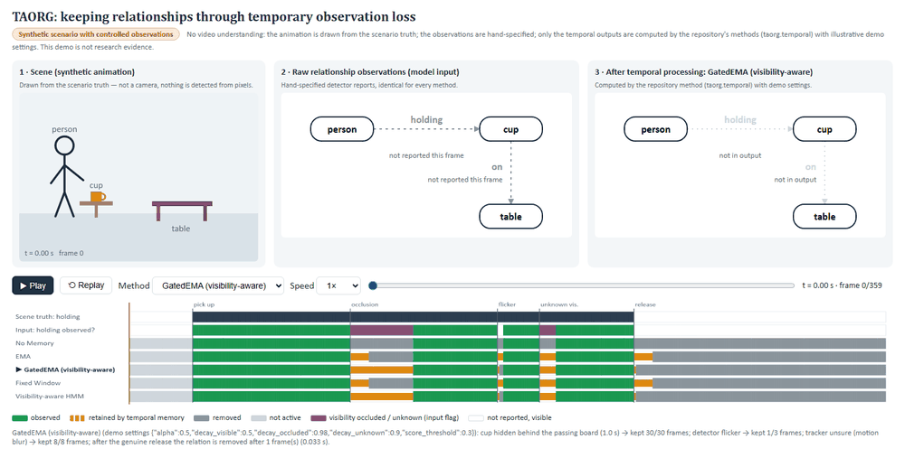

# TAORG presentation demo

**Synthetic scenario with controlled observations.** This is a presentation demo, not an experiment
and not research evidence.



## Run it

```bash
python demo/build_demo.py --open
```

This runs the repository's temporal methods and writes `demo/output/taorg_demo.html`, then opens
it in your browser. The page is a single self-contained file that works offline. You only need the
repository installed (`pip install -e .`); there are no extra dependencies. To open a specific
moment directly, add a URL hash, for example `taorg_demo.html#frame=120&method=ema`.

## What you see

| Panel | Content |
|---|---|
| 1 · Scene | A cartoon of a person picking up a cup. A board passes in front of the cup for 1 s, then the person puts the cup on the table. |
| 2 · Raw observations | What a hypothetical detector reports for this frame. This is the **model input**. |
| 3 · After temporal processing | The output of the selected repository method for the same frame. |
| Timeline | The scene truth, the input, and every method's output for *person → holding → cup*, with a playhead. |

Panel 3 uses four visual states:

- **Observed:** solid green.
- **Retained by temporal memory:** dashed orange. The method keeps the relation although the input missed it.
- **Removed:** dotted grey with ✕.
- **Unknown or unreliable visibility:** purple text and purple input. This shows the visibility flag that came with the missed observation.

The controls are play/pause, replay, a timeline slider, speed, and a method selector. The methods
are No Memory, EMA, GatedEMA, Fixed Window and Visibility-aware HMM. All five run through the same
`reset_video` / `step` / `finalize_video` interface.

## What is real, simulated, manually supplied and computed

| Item | Status | Where |
|---|---|---|
| Animation | **Simulated.** It is drawn from the scenario truth. No camera is used and nothing is detected from pixels. | `scenario.py` (`TRUTH`), `player.html` |
| Scenario truth (pick-up at frame 30, board over frames 105–134, release at frame 240) | **Manually supplied** | `scenario.py`, `output/scenario_truth.json` |
| Observations (observed flag, score 0.85, visibility flag per frame) | **Manually supplied.** They come from the truth plus three hand-written failures: the 1 s occlusion (flagged OCCLUDED), a 3-frame flicker while the cup is visible, and 8 frames with UNKNOWN visibility. | `scenario.py` (`FAILURES`), `output/observations.json` |
| Method parameters | **Illustrative demo settings.** They were hand-picked to make behaviour visible and were not tuned. | `build_demo.py` (`DEMO_METHODS`) |
| Temporal outputs and memory values | **Computed** by the actual repository classes in `taorg.temporal.METHODS`. | `output/demo_data.json` |
| Display state (observed / retained / removed) | **Derived** only from the model output and the model input. | `build_demo.py` (`display_states`) |

The models never see the truth. Every method receives the identical observation list, and its
SHA-256 hash is recorded per method in `demo_data.json`.

## What happens with these demo settings

| Method | Occlusion (30 frames) kept | Flicker (3, visible) kept | Unknown visibility (8) kept | Frames shown after the real release |
|---|---|---|---|---|
| No Memory | 0 | 0 | 0 | 0 |
| EMA | 9 | 3 | 8 | 9 (0.30 s) |
| GatedEMA | 30 | 1 | 8 | 1 (0.03 s) |
| Fixed Window (10) | 9 | 3 | 8 | 9 (0.30 s) |
| Visibility-aware HMM | 30 | 1 | 8 | 1 (0.03 s) |

How to read this honestly:

- The visibility-aware methods only bridge the occlusion because the input *says* the cup is
  occluded. When the cup is visible but missed (the flicker), they treat that as evidence and drop
  the relation quickly. EMA keeps it, but EMA also holds the relation for 0.3 s after the cup is
  really put down.
- Different parameters would change every number in this table. The table describes this
  constructed example only.
- The repository's own pre-registered results are in `Memory.md`. Phase 4 concluded
  METHOD CONTRIBUTION = NO: the visibility-aware filters are established-style baselines, not a
  new contribution. This demo does not change that.

## Verification

`tests/unit/test_demo.py` checks the following:

1. The embedded outputs equal a fresh run of each repository method, frame by frame.
2. The display state follows the model output.
3. Every method gets identical inputs, and those inputs contain no truth fields.
4. The scenario contains both a temporary loss and a genuine termination.
5. Frame counts and timestamps align.
6. The HTML embeds exactly the computed data.
7. **Browser check (headless Chrome).** The player is rendered at several frame/method pairs, and the
   rendered state is checked against the model output for that frame.
8. **Playback check.** After 4 s of playback the player shows frame ≈ 120, which is 30 fps.

## Files

| File | Role |
|---|---|
| `scenario.py` | Scenario truth and the observation failures |
| `build_demo.py` | Runs the methods and embeds the data into the player |
| `player.html` | Player template |
| `output/taorg_demo.html` | The built demo |
| `output/observations.json` | The model input |
| `output/scenario_truth.json` | The scenario truth |
| `output/demo_data.json` | All the data embedded in the demo |
| `output/screenshot_*.png` | Screenshots |
| `output/taorg_demo_recording.gif` | Recording: GatedEMA, every 6th frame, real time |
| `presenter_notes.md` | 30-second explanation |
